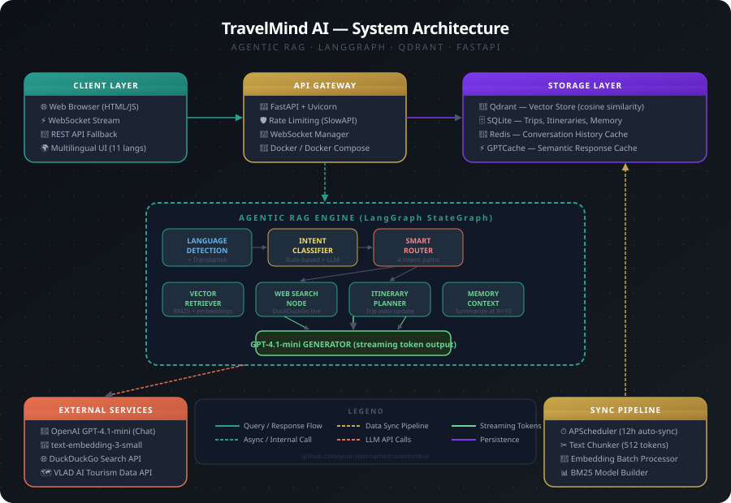

# 🧭 TravelMind AI

> **An Agentic RAG-powered travel chatbot** — real-time web search, smart itinerary planning, multilingual support, and persistent memory, all served over WebSockets with streaming token output.

[](https://python.org)
[](https://fastapi.tiangolo.com)
[](https://langchain-ai.github.io/langgraph)
[](https://qdrant.tech)
[](https://openai.com)
[](https://docker.com)
[](LICENSE)

---

### System Architecture


---

## ✨ Features

| Capability | Details |
|---|---|
| **Agentic RAG** | LangGraph `StateGraph` orchestrates multi-step retrieval, filtering, and generation |
| **Real-time Streaming** | WebSocket endpoint streams token-by-token responses to the browser |
| **Smart Intent Routing** | Rule-based + LLM fallback classifies queries into 4 paths: `knowledge_base`, `web_search`, `hybrid`, `out_of_scope` |
| **Multilingual** | Auto-detects user language; supports 11 languages (EN, RO, RU, FR, DE, ES, IT, PT, PL, UK, HU) |
| **Persistent Memory** | Conversation history summarized every 10 messages via OpenAI, stored in Redis |
| **Smart Itinerary** | AI extracts mentioned activities and auto-updates trip plans stored in SQLite |
| **Semantic Cache** | GPTCache deduplicates semantically similar queries to reduce API costs |
| **Auto Sync** | APScheduler fetches fresh tourism data every 12 hours; incremental or full rebuild |
| **Rate Limiting** | Per-IP and per-WebSocket connection rate limiting via SlowAPI + TokenBucket |
| **Docker-ready** | Single `docker-compose up` spins up app + Qdrant |

---

## 🏗 Architecture

```
User Query (WebSocket / REST)
        │
        ▼
┌─────────────────────────────────────────────────────────┐
│                  LangGraph StateGraph                    │
│                                                          │
│  Language Detection → Intent Classifier → Smart Router  │
│           │                    │                │       │
│    Translation             KB / Web        Festival /   │
│           │              Retriever        Accommodation │
│           └──────────────────────────────────┘          │
│                           │                             │
│              Context Middleware (Memory + Itinerary)    │
│                           │                             │
│              GPT-4.1-mini Generator (streaming)         │
└─────────────────────────────────────────────────────────┘
        │                               │
  Qdrant (vectors)              SQLite + Redis
  + BM25 hybrid                 (trips, memory)
        │
  Tourism Data API ←── APScheduler (12h sync)
```

See the full annotated diagram: [`assets/architecture.svg`](assets/architecture.svg)

---

## 📁 Project Structure

```
travelmind-ai/
├── app/
│   ├── api/
│   │   ├── routes.py              # REST endpoints (/query, /sync, /health)
│   │   ├── itinerary_routes.py    # Trip & itinerary CRUD
│   │   ├── websocket.py           # WebSocket streaming endpoint
│   │   └── rate_limiter.py        # Per-connection rate limiter
│   ├── core/
│   │   ├── config.py              # Pydantic Settings (all env vars)
│   │   ├── gpt_cache.py           # GPTCache semantic deduplication
│   │   ├── limiter.py             # TokenBucket rate limiter
│   │   └── logger.py              # Structured logging per module
│   ├── models/
│   │   ├── models.py              # SQLAlchemy ORM models
│   │   └── schemas.py             # Pydantic request/response schemas
│   ├── schemas/                   # API input/output Pydantic schemas
│   ├── services/
│   │   ├── agentic_rag_service.py # 🧠 Core: LangGraph multi-node pipeline
│   │   ├── rag_service.py         # Classic RAG (non-agentic fallback)
│   │   ├── embedding_service.py   # OpenAI text-embedding-3-small
│   │   ├── vector_store.py        # Qdrant client + BM25 hybrid search
│   │   ├── intent_classifier.py   # Rule-based + LLM intent routing
│   │   ├── translation_service.py # LangChain multilingual translation
│   │   ├── external_memory_service.py  # Redis + summary compression
│   │   ├── context_middleware.py  # Injects memory + itinerary context
│   │   ├── itinerary_service.py   # Trip CRUD + AI activity extraction
│   │   ├── sync_service.py        # Incremental + full knowledge base sync
│   │   ├── data_fetcher.py        # Tourism API client
│   │   ├── web_search_service.py  # DuckDuckGo live search
│   │   ├── query_rewriter_service.py # Query normalisation
│   │   ├── prompt_template_service.py # System prompt builder
│   │   └── scheduler.py           # APScheduler background job
│   └── main.py                    # FastAPI app factory + service wiring
├── frontend/
│   └── index.html                 # Single-file chat UI (WebSocket + REST)
├── assets/
│   ├── architecture.svg           # System architecture diagram
│   └── screenshots/               # 📷 Add your screenshots here
├── data/
│   └── logs/                      # Per-service structured logs
├── .env.example                   # All configurable environment variables
├── docker-compose.yml             # App + Qdrant vector DB
├── Dockerfile
└── requirements.txt
```

---

## 🚀 Quick Start

### Prerequisites

- Python 3.11+
- Docker & Docker Compose
- OpenAI API key

### 1. Clone & Configure

```bash
git clone https://github.com/hiborn4/TravelMind_AI_Backend.git
cd travelmind-ai

cp .env.example .env
# Edit .env — at minimum set:
#   OPENAI_API_KEY=sk-...
#   VLAD_AI_API_KEY=...
```

### 2. Start Qdrant (Vector Database)

```bash
docker-compose up -d qdrant
```

### 3. Install & Run

```bash
python -m venv venv
source venv/bin/activate        # Windows: venv\Scripts\activate
pip install -r requirements.txt

# Start the server
uvicorn app.main:app --host 0.0.0.0 --port 8000 --reload
```

### 4. Populate the Knowledge Base

```bash
# Incremental sync (recommended for regular use)
curl -X POST http://localhost:8000/api/sync

# Full rebuild (first time or when source data changes significantly)
curl -X POST http://localhost:8000/api/sync/full
```

### 5. Open the Chat UI

Navigate to [http://localhost:8000](http://localhost:8000) — or open `frontend/index.html` directly in your browser, pointing the WebSocket URL to `ws://localhost:8000/ws/chat`.

---

### Docker (All-in-One)

```bash
docker-compose up --build
```

The compose file starts both the FastAPI app and Qdrant. The app is available on `http://localhost:8000`.

---

## ⚙️ Configuration

All settings are driven by environment variables (see `.env.example`):

| Variable | Default | Description |
|---|---|---|
| `OPENAI_API_KEY` | **required** | OpenAI API key |
| `VLAD_AI_API_KEY` | **required** | Tourism data source API key |
| `QDRANT_HOST` | `qdrant` | Qdrant host (use `localhost` for local dev) |
| `QDRANT_COLLECTION_NAME` | `vlad_ai_cleaned` | Vector collection name |
| `REDIS_URL` | `redis://localhost:6379` | Redis for conversation memory |
| `REDIS_ENABLED` | `true` | Set `false` to use in-memory fallback |
| `OPENAI_CHAT_MODEL` | `gpt-4.1-mini` | Chat completion model |
| `OPENAI_EMBEDDING_MODEL` | `text-embedding-3-small` | Embedding model |
| `SYNC_INTERVAL_HOURS` | `12` | Auto-sync frequency |
| `CHUNK_SIZE` | `512` | Document chunk size (tokens) |
| `MAX_CONTEXT_TOKENS` | `3000` | Max tokens injected into prompt |
| `ENABLE_TRANSLATION` | `true` | Multilingual response translation |

---

## 🔌 API Reference

### REST

| Method | Endpoint | Description |
|---|---|---|
| `POST` | `/api/query` | Non-streaming chat query |
| `GET`  | `/api/health` | Health check |
| `POST` | `/api/sync` | Trigger incremental knowledge base sync |
| `POST` | `/api/sync/full` | Full knowledge base rebuild |
| `GET`  | `/api/sync/info` | Sync status + vector store stats |
| `POST` | `/api/user/language` | Update user language preference |
| `POST` | `/api/itinerary/trips` | Create a new trip |
| `GET`  | `/api/itinerary/trips/{id}` | Get trip with full itinerary |

### WebSocket

Connect to `ws://localhost:8000/ws/chat` and send:

```json
{
  "query": "What are the best hiking trails near Brasov?",
  "use_agent": true,
  "trip_id": 1,
  "top_k": 5
}
```

The server streams JSON frames:

```json
{ "type": "intent",  "content": "attractions" }
{ "type": "answer",  "content": "Here are the top..." }
{ "type": "sources", "content": ["Trail Database", "Local Guide"] }
{ "done": true }
```

---

## 🧠 How the Agentic Pipeline Works

```
1. LANGUAGE DETECTION  — detects user language, translates query to English if needed
2. INTENT CLASSIFIER   — rule-based patterns first, LLM fallback for ambiguous queries
                          → accommodations / restaurants / attractions / festivals
                          → weather / trip_planning / price_inquiry / out_of_scope
3. SMART ROUTER        — dispatches to specialised retrieval nodes:
   ├── Vector Retriever     (Qdrant cosine + BM25 hybrid re-rank)
   ├── Web Search Node      (DuckDuckGo for live weather / events)
   ├── Itinerary Planner    (extracts activities, updates SQLite trip)
   └── Memory Context       (injects summarised conversation history)
4. GENERATOR           — GPT-4.1-mini with injected context, streams tokens
5. TRANSLATION         — translates response back to user's language if needed
6. MEMORY UPDATE       — saves message, triggers summary compression at N=10
```

---

## 📦 Tech Stack

**Backend**
- [FastAPI](https://fastapi.tiangolo.com) — async REST + WebSocket API
- [LangGraph](https://langchain-ai.github.io/langgraph) — stateful multi-node agent graph
- [LangChain](https://langchain.com) — LLM abstraction, prompt templates
- [Qdrant](https://qdrant.tech) — high-performance vector database
- [OpenAI](https://openai.com) — GPT-4.1-mini (chat) + text-embedding-3-small
- [SQLAlchemy](https://sqlalchemy.org) — ORM for SQLite (trips, memory, sync metadata)
- [Redis](https://redis.io) — conversation history with TTL
- [GPTCache](https://github.com/zilliztech/GPTCache) — semantic query deduplication
- [APScheduler](https://apscheduler.readthedocs.io) — background sync scheduling
- [SlowAPI](https://github.com/laurentS/slowapi) — rate limiting middleware

**Frontend**
- Pure HTML/CSS/JS — zero dependencies, single file
- Google Fonts: Playfair Display + DM Sans + DM Mono
- WebSocket-first with REST fallback

**Infrastructure**
- Docker + Docker Compose
- Uvicorn ASGI server

---

## 🗺️ Deployment (Free Options)

Since this project includes a Qdrant vector DB dependency, the easiest free deployment path is:

| Service | What to Host | Notes |
|---|---|---|
| [Railway](https://railway.app) | FastAPI backend | Free tier, Docker support |
| [Qdrant Cloud](https://cloud.qdrant.io) | Vector database | Free cluster (1GB) |
| [Redis Cloud](https://redis.com/try-free/) | Conversation memory | Free 30MB instance |
| [GitHub Pages](https://pages.github.com) | `frontend/index.html` | Point WS URL to your Railway deploy |

> **Tip:** Set `REDIS_ENABLED=false` to skip Redis and use in-memory fallback — useful for demo deployments.

---

## 📸 Screenshots Guide

Run the app and capture the following to complete the README:

```
01-chat-interface.png   — Full UI: sidebar + active chat with streaming response
02-itinerary.png        — Trip planning conversation + sidebar trip selector
03-multilingual.png     — Language switch demo (dropdown + response in another lang)
04-sync-status.png      — Sidebar status panel after a successful sync
05-architecture.png     — Optional: architecture.svg rendered in browser
```

**Recommended size:** 1400×900px, PNG. Use browser zoom at 100% for crisp captures.

---

## 🤝 Contributing

Contributions, issues, and feature requests are welcome. Please open an issue first to discuss what you'd like to change.

---

## 📄 License

MIT © 2025 — Built with ❤️ and a lot of coffee.

---

<p align="center">
  <em>Built as a showcase of production-grade agentic AI systems.</em><br/>
  <em>If this project helped you, consider giving it a ⭐</em>
</p>
